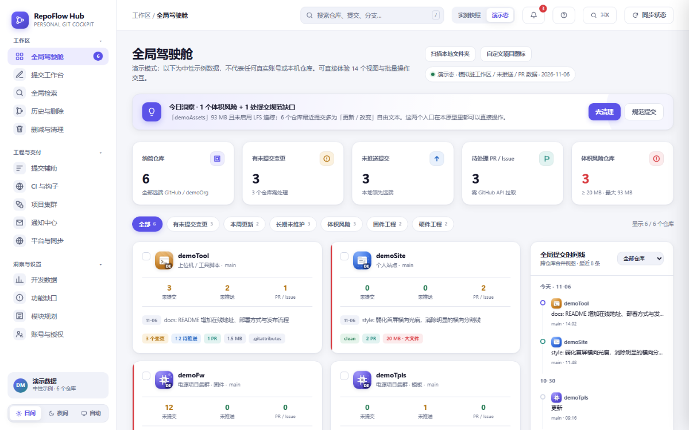
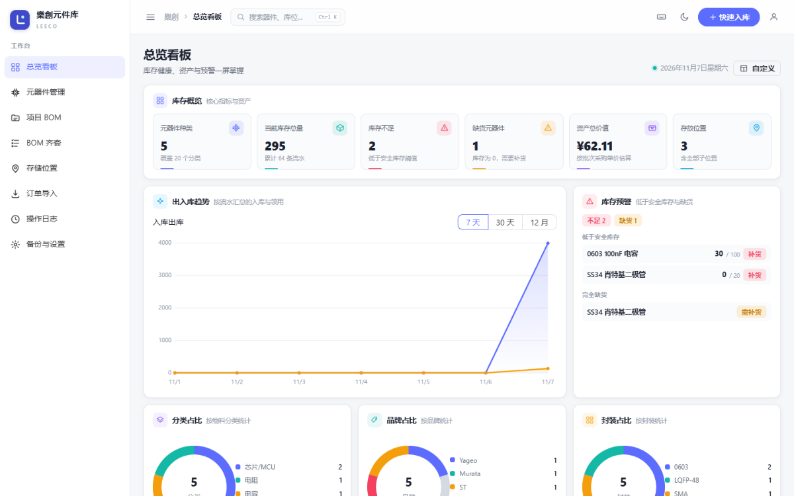
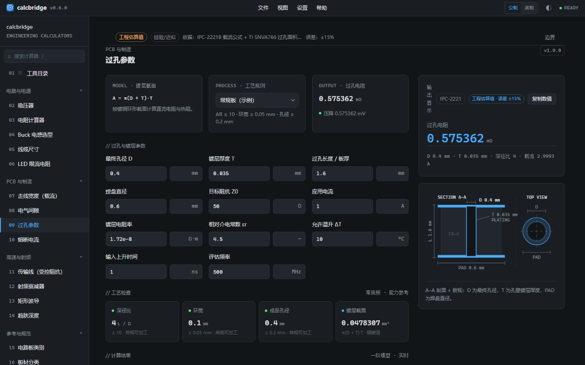
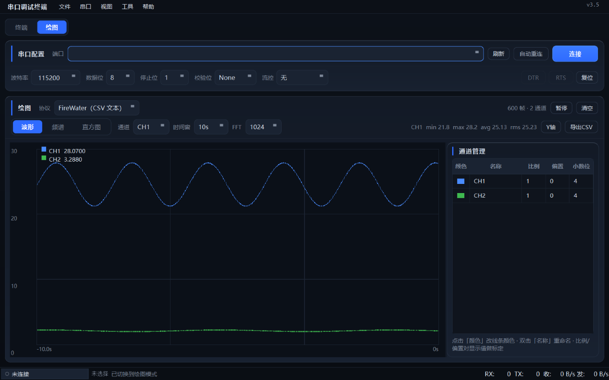

<!-- 亮/暗两套横幅，GitHub 按主题只显示其中一张；动画由 SVG 自身驱动，不依赖第三方服务 -->

  
  

  <b>全栈工程师</b> · 电源拓扑 / 嵌入式固件 / Web 与云原生 
  从电路板到容器，整条链路亲手打通。

  
  
  

## 概览

从电源与嵌入式起步，把同一套工程方法带到 Web 与云上：**先测量，后假设，一次只改一个变量**。桌上常年摆着示波器、逻辑分析仪和一摞 PCB；也做上位机与 Web 全栈，用容器让服务长期稳定运行。

> 最近在做的，是把串口调试与固件烧录搬进浏览器：纯前端 Web Serial，固件不出本机。

## 软件项目

四套自研工具，全部开源：仓库、库存、计算、调试。

<table>
  <tr>
    <td width="50%" valign="top">
       
      <b><a href="https://github.com/LeChuangDev/repoflow-hub">RepoFlow Hub</a></b> 
      多仓库 Git 驾驶舱：单文件 HTML、零依赖；网页版连远端仓库，离线版只读扫描本机 .git 仓库。  
      <code>TypeScript</code> <code>单文件</code> <code>Git</code>
    </td>
    <td width="50%" valign="top">
       
      <b><a href="https://github.com/LeChuangDev/leeco-partshub">Leeco-PartsHub</a></b> 
      元器件库存系统：订单导入、批次库位、扫码出入库与 BOM 齐套，静态前端 + 边缘 KV。  
      <code>Vue 3</code> <code>TypeScript</code> <code>EdgeOne</code>
    </td>
  </tr>
</table>

 

<table>
  <tr>
    <td width="50%" valign="top">
       
      <b><a href="https://github.com/LeChuangDev/calcbridge">CalcBridge</a></b> 
      面板式工程计算器：19 个模块覆盖电源、PCB 与高速射频，每个结果可追溯到公式与标准。  
      <code>React</code> <code>TypeScript</code> <code>IPC-2221</code>
    </td>
    <td width="50%" valign="top">
       
      <b><a href="https://github.com/LeChuangDev/serial_tool">Leeco-Serial</a></b> 
      串口调试终端：命令行与 VOFA+ 风格实时绘图双模，掉线自动重连、CRC16、定时发送。  
      <code>Python</code> <code>PyQt6</code> <code>pyserial</code>
    </td>
  </tr>
</table>

## 硬件与固件

板子自己画，电路自己调，固件自己写。

<table>
  <tr>
    <td width="50%" valign="top">
      <b><a href="https://github.com/LeChuangDev/G431_Volt">G431_Volt</a></b> 
      STM32G431 数控电源固件：0–36 V / 0–3 A、CV/CC 双环、USB-PD 输入协商、全链路保护与 ESP32 遥测；裸机 C，无 HAL、无 RTOS。  
      <code>C</code> <code>STM32G431</code> <code>USB-PD</code>
    </td>
    <td width="50%" valign="top">
      <b><a href="https://github.com/LeChuangDev/adjustable-power">adjustable-power</a></b> 
      ESP32 数控可调电源：ESP-IDF 分层架构、ADC 采样 + PID 闭环、OTA 升级与多重保护，支持 ESP32 / C3 / S3。  
      <code>ESP-IDF</code> <code>ESP32</code> <code>PID</code>
    </td>
  </tr>
</table>

 

**还在维护**：[mcu-demo-templates](https://github.com/LeChuangDev/mcu-demo-templates)（ARM-GCC + CMake 固件模板） · [樂創視界](https://zhangwenle.com)（技术站与在线工具箱） · [KiCad 笔记](https://github.com/LeChuangDev/LeChuang-KiCad-Notes)（原理图、库管理、制造输出） · [嘉立创 EDA 笔记](https://github.com/LeChuangDev/Leeco-Jialichuang-EDA-Notes)（原理图与制版资料）

<a href="https://github.com/LeChuangDev?tab=repositories"><b>全部仓库 →</b></a>

## 技术栈

一条命令看完工具链。

  
  

## 工程信条

> **先测量后假设** —— 用示波器与逻辑分析仪收敛问题，不靠猜。 
> **单变量迭代** —— 一次只改一处，让根因无处可藏。 
> **全流程沉淀** —— 每个项目都留文档，让经验可以复用。

## 成长轨迹

每天的提交，由 Actions 重绘成一条贪吃蛇。

  
  

<!-- code_time starts -->
<!-- code_time ends -->

  樂創 · 从硅片到云端　|　<a href="https://zhangwenle.com">zhangwenle.com</a> · <a href="mailto:dev@zhangwenle.com">dev@zhangwenle.com</a>

